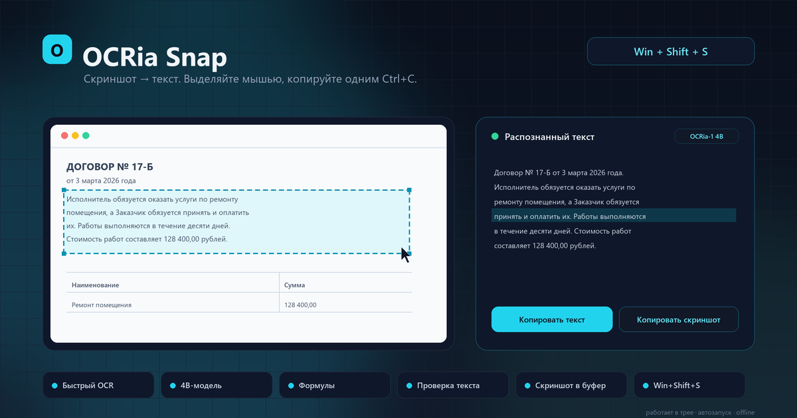

# OCRia Snap




[](https://github.com/Lolik227-spec/OCRia-Snap/releases/latest)

**Скачать:** [последний релиз](https://github.com/Lolik227-spec/OCRia-Snap/releases/latest) ·
**Исходники:** [GitHub](https://github.com/Lolik227-spec/OCRia-Snap)

Свой «Lightshot» со встроенным OCR: выделили область экрана — и тут же мышью выделяете
на ней текст, как обычный. Один поток, без второго окна. Локально, без интернета, на CPU.
Движок: модели **OCRia-nano-1** (LlamaIndex, 8.1M параметров) через `liteparse`.

## Как это работает

1. Жмёте `Win+Shift+S` — экран **замирает** и темнеет. Картинка зафиксирована, поэтому
   можете не спешить и спокойно выбрать зону.
2. Тянете рамку. Пока тянете — видно размер в пикселях.
3. Отпустили — под рамкой сразу появляется текстовый слой: слова подчёркнуты зелёным пунктиром.
4. Тяните мышью по словам — выделенное подсвечивается. Копируете вручную: `Ctrl+C` или кнопкой.
   Клик по слову — выделить одно слово, `Ctrl+A` — выделить всё.

**Ничего не копируется само.** Ни при снимке, ни при выделении мышью, ни после распознавания —
только по `Ctrl+C` или по нажатию кнопки.

| Кнопка | Что кладёт в буфер |
|---|---|
| `Копировать выделенное` | только выделенные вами слова (это же делает `Ctrl+C`) |
| `Копировать весь текст` | весь распознанный текст зоны |
| `Копировать скриншот` | картинку зоны (только её, без текста) |

Текст копируется **всегда без картинки** — они не смешиваются. Каждый снимок дополнительно
сохраняется в `captures\`.

Поведение `Ctrl+C` зависит от того, есть ли выделение:

- **есть выделенный текст** → копируется только он;
- **ничего не выделено** → копируется сам скриншот зоны (как в Lightshot).

Остальные кнопки под рамкой: `Выделить всё`, `Сохранить .txt`, `Сохранить картинку`,
`Другая область` (перевыбрать зону, не закрывая окно), `Разметка` (скрыть подчёркивание),
`Закрыть`. `Esc` — закрыть. Под рамкой видно, сколько слов и символов выделено.

## Отключить ножницы винды

`Win+Shift+S` изначально занята системным инструментом, поэтому OCRia Snap её не получает.
Скрипт отдаёт комбинацию нашему софту:

```
tools\take-over-winshifts.cmd   :: выставить DisabledHotkeys=S и перезапустить проводник
tools\restore-winshifts.cmd     :: вернуть как было
tools\check-hotkey.py           :: проверить, свободна ли комбинация
```

**Побочный эффект:** вместе с `Win+Shift+S` перестаёт работать `Win+S` (поиск винды) — они
делят одну букву. Значение реестра сохраняется в `tools\winshifts-backup.txt`, откат — одним запуском.

Пока комбинация занята, запасной вариант — `Win+Shift+X`, а также `Ctrl+Alt+S`/`Ctrl+Alt+V`.

## Горячие клавиши

| Комбинация | Что делает |
|---|---|
| `Win+Shift+S` | основной: рамка → выделяемый текст |
| `Win+Shift+X` | то же (запасная, свободна сразу) |
| `Win+Ctrl+Shift+S` | рамка → **картинка зоны сразу в буфер**, без OCR и панели |
| `Ctrl+Alt+A` | рамка → **OCRia-1 (4B)** через Ollama, точное распознавание (окно с текстом) |
| `Ctrl+Alt+V` | то же, но для картинки, которая уже лежит в буфере |
| `Ctrl+Alt+S` | рамка → весь текст сразу в буфер, без текстового слоя |

Комбинации проверяются через `RegisterHotKey`: если какая-то занята другой программой,
приложение её пропускает и пишет об этом во всплывающей подсказке при запуске.

## Запуск и автозагрузка

```
start-ocria-snap.cmd            :: запустить сейчас (или launch.vbs — без окна консоли)
tools\install-autostart.cmd     :: включить автозапуск при входе в систему
tools\remove-autostart.cmd      :: выключить автозапуск
```

`tools\install-autostart.cmd` создаёт в папке «Автозагрузка» обычный ярлык **с иконкой** приложения:

```
%APPDATA%\Microsoft\Windows\Start Menu\Programs\Startup\OCRia Snap.lnk
```

Пути к `pythonw.exe`, к `ocria_snap.pyw` и к иконке подставляются автоматически в момент
установки, поэтому автозапуск не сломается, если папку перенести. Старый способ через `.vbs`
удаляется. Сразу после установки скрипт запускает приложение и проверяет, что процесс поднялся.

Приложение одноэкземплярное: повторный запуск (в том числе вторым ярлыком) просто выходит,
дублировать иконки в трее не будет.

Проверка OCR без GUI:

```
py ocria_snap.pyw --selftest samples\ru_test.png
```

## Настройки — `config.json`

| Ключ | Смысл |
|---|---|
| `engine` | движок для `Win+Shift+S`: `nano` (по умолчанию) или `ai` (OCRia-1 4B) |
| `hotkeys.snip` | комбинации для режима рамки, по умолчанию `["win+shift+s", "win+shift+x"]` |
| `hotkeys.snip_image` | рамка → картинка в буфер, по умолчанию `["win+ctrl+shift+s"]` |
| `hotkeys.snip_ai` | рамка → OCRia-1 (4B), по умолчанию `["ctrl+alt+a"]` |
| `hotkeys.clipboard` | для картинки из буфера, по умолчанию `["ctrl+alt+v"]` |
| `ai_engine.model` | модель Ollama, по умолчанию `llamaindex/ocria-1:q8_0` |
| `ai_engine.keep_alive` | через сколько освободить VRAM после простоя, по умолчанию `2m` |
| `ai_engine.upscale` | растяжение мелких скриншотов, по умолчанию `1.0` (замером: растяжение вдвое медленнее и хуже) |
| `ai_engine.num_ctx` / `num_predict` / `max_pixels` | контекст, лимит вывода, лимит пикселей |
| `solver.model` | модель, которая решает задачи, по умолчанию `qwen2.5:1.5b` |
| `solver.tools` | `true` — разрешить калькулятор для точной арифметики |
| `solver.prompt` | свой системный промпт для решения (`null` — встроенный) |
| `checker.model` | модель для проверки текста (по умолчанию как у решалки) |
| `checker.engine` | `model` (по умолчанию) или `rules` — LanguageTool |
| `checker.check_prompt` | свой промпт корректора (`null` — встроенный) |
| `hotkeys.silent_copy` | молчаливый режим, по умолчанию `["ctrl+alt+s"]` |
| `copy_on_select` | `false` (по умолчанию) — копировать по `Ctrl+C`; `true` — копировать сразу по отпусканию мыши |
| `clipboard_action` | следить ли за буфером обмена (`off` по умолчанию; `overlay`/`copy` — если пользуетесь системными ножницами) |
| `save_captures` | складывать снимки в `captures\` |
| `markup_visible` | показывать подчёркивание слов сразу |
| `preprocess` | `true` — перед OCR: тёмный фон инвертируется, картинка в серый + автоконтраст |
| `fix_cyrillic` | `true` — чистка кириллицы: латинские и греческие двойники, регистр |
| `output_format` | формат для `Ctrl+Alt+S`: `text` или `markdown` |
| `dpi` | DPI рендера для OCR, по умолчанию 250 |

Поддерживаются имена модификаторов `ctrl`, `alt`, `shift`, `win` и особые клавиши
`printscreen`, `insert`, `pause`, `scrolllock`.

**Если где-то вставляется картинка вместо текста** — так быть не должно: текст и картинка
копируются раздельно, картинка только кнопкой `Копировать скриншот`.

## Файлы

```
ocria_snap.pyw              приложение (трей, рамка, текстовый слой, OCR, буфер)
ocria_render.py             красивый вывод: формулы LaTeX и таблицы -> картинка
config.example.json         пример настроек (рабочий config.json создаётся сам)
assets/ocria-snap.ico       иконка приложения и значка в трее
assets/icon-source.png      исходник иконки
assets/promo.png            картинка для README и соцсетей
samples/ru_test.png         тестовая страница с русским текстом
captures/                   сохранённые снимки (создаётся при работе)
start-ocria-snap.cmd        запуск без консоли
launch.vbs                  то же самое, двойным щелчком
tools/                      все вспомогательные скрипты:
  take-over-winshifts.cmd     забрать Win+Shift+S у винды
  restore-winshifts.cmd       откатить
  install-autostart.cmd       автозапуск: ярлык с иконкой в «Автозагрузке»
  remove-autostart.cmd        убрать из автозагрузки
  install-shortcut.vbs        создание ярлыка (вызывается установщиком)
  make-icon.py                сборка .ico из картинки
  make-promo.py               сборка баннера assets/promo.png
  check-hotkey.py             проверка занятости Win+Shift+S
  fetch-models.py             ручная закачка модели
  bench.py                    бенчмарк качества OCR (CER на синтетике с эталоном)
  test-ai.py                  юнит-проверки клиента OCRia-1 (без модели)
  make-sample.py              генератор тестовой страницы
```

Модели: `%LOCALAPPDATA%\liteparse\models\ocria-nano`.
Переустановить — `lit models pull ocria-nano`, удалить — `lit models rm ocria-nano`.

## Значок в трее и выбор модели

В трее (рядом с часами, возможно под стрелкой `^`) висит значок OCRia Snap. Правой кнопкой —
меню:

```
OCRia Snap · OCRia-nano (быстрая)
─────────────────────────────────
Модель распознавания  ▸  ◉ nano — быстрая (8.1M, CPU)
                         ○ OCRia-1 — точная (4B, GPU)
Держать модель в памяти ▸  ◉ 2 минуты после снимка
                           ○ 30 минут
                           ○ до выхода из программы
Прогреть модель сейчас
Выгрузить, освободить VRAM
─────────────────────────────────
Снять область            Win+Shift+S
Скопировать снимок       Win+Ctrl+Shift+S
Точная модель (4B)       Ctrl+Alt+A
Папка со снимками
─────────────────────────────────
Выход
```

Выбор модели переключает **основную** комбинацию `Win+Shift+S`: на `nano` открывается окно с
выделяемым текстом, на `OCRia-1` — рамка сразу уходит в 4B и открывается окно с текстом.
Выбор сохраняется в `config.json` и переживает перезагрузку.

Значок подписан текущей моделью, так что видно, что включено. Если значка не видно — нажмите
стрелку `^` слева от часов и перетащите его на панель.

## Точный движок: OCRia-1 (4B) через Ollama

Когда нужен максимум точности (смешанный код, таблицы, мелкий текст), есть второй движок —
старший брат `llamaindex/OCRia-1`, полноценная VLM на 4B. Это тот же OCRia, что первый среди
open-weight моделей на ParseBench 2 (85.2 против 59.2 у nano).

**Как запустить:** `Ctrl+Alt+A` — рамка и сразу распознавание через 4B. Либо в окне nano нажать
кнопку `Точнее: OCRia-1 (4B)` — та же зона уйдёт в 4B. Результат открывается отдельным окном с
текстом: выделяете мышью и `Ctrl+C`, либо кнопки `Копировать всё` / `Копировать выделенное`.

**Красивый вывод.** 4B отдаёт ответ как Markdown: формулы в LaTeX (`$$\sqrt{2x-3}+\sqrt{4x+1}=4.$$`),
таблицы в HTML. Поэтому в окне есть переключатель `Красиво` / `Текст`:

- `Красиво` — формулы отрисованы как настоящие (корни, дроби, интегралы, степени), таблицы — сеткой,
  заголовки — крупным жирным. Рисуется локально через matplotlib, ему не нужен ни LaTeX, ни интернет;
- `Текст` — исходный текст для копирования (там же кнопка `Markdown` показывает разметку как есть).

Если в ответе есть формулы или таблицы, окно сразу открывается в виде `Красиво`.

**Копирование картинкой.** Формулу или таблицу можно взять не только текстом:

- **наведите на блок в виде `Красиво`** — курсор станет рукой, внизу появится подсказка
  «нажмите — скопировать картинкой». Клик кладёт в буфер **именно этот блок**: формулу,
  таблицу или абзац. Лишние белые поля обрезаются;
- кнопка `Картинкой всю` — вся распознанная страница одной картинкой;
- кнопка `Сохранить .png` — то же самое файлом.

Копируется картинка на **белом фоне с тёмным текстом** — специально, чтобы нормально вставлялась
в Word, мессенджер или презентацию. На экране при этом вид тёмный, под тему приложения: прозрачный
фон при вставке в документ стал бы чёрным, поэтому для копирования рендер делается отдельно.

Рендерер — `ocria_render.py`, ему нужен `matplotlib` (`py -m pip install matplotlib`). Если его нет,
вид `Красиво` напишет об этом, а текст продолжит работать.

**Что нужно:** Ollama не старее 0.40.18 и сама модель:

```
ollama pull llamaindex/ocria-1:q8_0      :: 5.8 ГБ
```

Качать только Q8_0. Есть независимое предрегистрированное исследование квантов (12 244 кропа и
170 страниц, доверительные интервалы 95%): Q8_0 не отличается от BF16, а **все более компактные
варианты провалили хотя бы один тест** —

| Квант | Размер | Вердикт |
|---|---|---|
| Q8_0 | 5.2 ГБ | прошёл, отличий от BF16 нет |
| Q6_K | 4.0 ГБ | провал: −1.14 pp на печатном тексте |
| Q5_K_M | 3.5 ГБ | провал: −0.81 pp на строках чеков |
| Q4_K_M | 3.1 ГБ | провал |

Результаты при этом не монотонны по битам (Q6_K провалился, Q5_K_M прошёл тест на страницах) —
то есть дело не только в размере. Издатель тоже не выпускает 4-бит: у него потеря 6.3 пункта на
финансовых таблицах.

**Про видеопамять и скорость.** Замерено на RTX 2060 SUPER (8 ГБ): модель занимает **5.0 ГБ**
и влезает в память целиком — `offloaded 33/33 layers to GPU`, визуальный энкодер тоже на GPU
(`mtmd_backends: using CUDA0 backend`). Контекст стоит 8192, поэтому KV-кэш всего 136 МБ — с
дефолтными 32k модель бы уже не поместилась.

| Ситуация | Время на фрагмент |
|---|---|
| первый вызов, модель не загружена | **~2.5 минуты** (из них ~98 с — загрузка весов в VRAM) |
| модель уже в памяти | **1.3–1.5 секунды** |

Поэтому важна настройка `keep_alive`: по умолчанию модель выгружается через 2 минуты простоя и
видеопамять освобождается. Если нужна мгновенная реакция на каждый снимок — в меню трея есть
`Держать модель в памяти` (30 минут или до выхода) и `Прогреть модель сейчас`, чтобы заплатить
разовую паузу заранее. `Выгрузить, освободить VRAM` освобождает память немедленно.

При переключении на 4B модель прогревается в фоне автоматически.

**Защита от зацикливания.** Модель примерно на 3% страниц уходит в повтор одного блока до лимита
токенов. В клиенте есть обрезка: ищется наименьший период строго периодичного хвоста, остаётся
один повтор. На нормальном тексте не срабатывает (проверено на 54 437 символах — 0 мс).

## Решение задач: кнопка «Решить»

Важно понимать, кто что делает: **OCRia-1 только читает** страницу и переводит её в разметку — её
учили транскрибировать, а не считать. Просить её решать уравнение — значит просить делать то, чему
её не учили.

Поэтому решение вынесено в отдельную модель. В окне результата есть кнопка **`Решить`**: она
отправляет распознанный текст обычной языковой модели, а ответ открывает **отдельным окном** — с тем
же красивым рендером, так что формулы в решении тоже отрисовываются. Решение можно скопировать
текстом или картинкой, как и всё остальное.

Модель для решения выбирается в трее: **`Решать моделью`** (список берётся из установленных,
отсортирован по размеру) или в `config.json` → `solver.model`.

По умолчанию — `qwen2.5:1.5b`, самая маленькая:

```
ollama pull qwen2.5:1.5b      :: 986 МБ
```

**Встроенный калькулятор.** Модель не считает в уме: для умножений, делений и процентов она
вызывает инструмент `calc`, а выражение вычисляется на нашей стороне разбором AST — **без `eval`**,
то есть исполнить чужой код через это невозможно. Калькулятор понимает и пробелы, и русскую запятую
как десятичный разделитель: `1 250 * 34,50` даёт ровно `43125`. Отключить можно через
`solver.tools: false`.

Что получается на практике — сравнение двух моделей на одних и тех же задачах с включённым
калькулятором:

| Задача | `qwen2.5:1.5b` (986 МБ) | `qwythos-9b` (5.8 ГБ) |
|---|---|---|
| 15% от 240 | верно | верно |
| 1200 → +15% → −10% | **верно (1242)** | неверно (1314) |
| НДС 20% из суммы 60 000 | неверно | **верно (10 000)** |
| пропорция 5 кг → 8 кг | верно | неверно (280) |
| среднее чисел | неверно (23) | **верно (18)** |
| сумма по таблице | неверно | **верно (43 125)** |
| заполнить ячейку таблицы | неверно | **верно (153 120)** |
| **итого** | **3 из 7** | **5 из 7** |

Поэтому по умолчанию стоит **`qwythos-9b`**: он лучше считает, аккуратнее обращается с русским
форматом чисел (`3 190,00` разбирает правильно) и честно признаёт ход решения. Учтите: 9B занимает
5.8 ГБ видеопамяти, поэтому вместе с 4B-OCR (тоже ~5 ГБ) они не уживаются — при переключении между
распознаванием и решением Ollama перезагружает модель. Если распознаёте через nano (он на CPU), этой
проблемы нет.

Что стабильно получается у обеих моделей: линейные, квадратные уравнения и системы, проценты от
числа, пропорции, перевод единиц, вопросы по тексту. Где ждите ошибок: сложные алгебраические
уравнения (иррациональные), редкие форматы чисел и задания по русскому языку — там модель 1.5B
ошибается чаще. **Арифметику всегда проверяйте глазами**: модель не обязана звать калькулятор, и
именно на этом она спотыкается чаще всего.

Запомните цепочку: **скан читает OCR (nano или 4B), считает языковая модель, арифметику считает
калькулятор.** Если распознавание ошиблось, ответ тоже будет неверным — сначала смотрите на
распознанный текст.

## Проверка орфографии и пунктуации

Кнопка **`Проверить`** в окне результата и пункт **`Проверить последний текст`** в трее (неактивен,
пока ничего не распознано).

Что исправляет: орфографию (русские слова — по правилам русского языка, английские — по правилам
английского), пунктуацию, падежи и согласование, заглавные буквы в начале предложений и в именах
собственных. Правила LanguageTool детерминированы и физически не умеют переписывать фразы; у
модели это запрещено промптом, а результат дополнительно проверяется по длине.

Правки **не применяются молча**: открывается окно с исправленным текстом, где все изменения
подсвечены зелёным, а кнопкой `Что было` можно посмотреть исходник и сравнить. Скопировать можно
как исправленное целиком, так и выделенный кусок.

Моделью замерено на семи текстах:

| Что проверяли | Результат |
|---|---|
| русская орфография (`Превет`, `зделали`) | исправлено всё |
| русская пунктуация (без запятых и точки) | «…в лес, там было тихо и красиво, но…» |
| русские падежи (`два килограмм яблоки`) | «два килограмма яблок… их сестре» |
| английская орфография (`beleive`, `teh`) | `believe`, `the`, `doesn't` |
| английская пунктуация (`however`) | `However,` + точка в конце |
| **верный русский текст** | **0 правок** |
| **верный английский текст** | **0 правок** |

Две последние строки — главное: на правильном тексте не меняется ничего, включая `128 400,00 руб.`,
дату и `$34.50`.

Модель для проверки берётся из `solver.model`, переопределить можно через `checker.model`.
Если Java не найдена, проверка сама откатывается на модель — текст не останется без проверки.

**Два движка проверки** — выбираются в трее, пункт `Проверять текст`:

| | `моделью` | `правилами` (LanguageTool, по умолчанию) |
|---|---|---|
| Как работает | языковая модель по промпту | наборы правил, детерминированно |
| Объясняет правку | нет | **да, с названием правила** (кнопка `Правила`) |
| Может переписать текст | может — ловим проверкой длины | **нет, не умеет** |
| Русский | падежи и согласование берёт лучше | орфография по словарю + часть грамматики |
| Английский | хорошо | **богатый набор правил, строже** |
| Нужно ставить | ничего | Java + LanguageTool (≈400 МБ) |

LanguageTool включает так:

```
winget install EclipseAdoptium.Temurin.17.JRE
py -m pip install language-tool-python
```

При первом запуске движок скачает себя (≈230 МБ) и поднимется локально — текст никуда не
отправляется. Работает офлайн.

Замерено на тех же текстах:

| Проверено правилами | Результат |
|---|---|
| `Превет`, `дила`, `состовляет` | `Привет`, `дело`, `составляет` |
| `красиво но` | `красиво, но` |
| `два килограмм` | `два килограмма` |
| `beleive`, `teh`, `dont`, `but` | `believe`, `the`, `don't`, `, but` |
| **верный русский и английский** | **0 правок** |

Сервер LanguageTool поднимается один раз и сам определяет язык по каждому запросу, поэтому
переключение между русским и английским не перезапускает Java. Если выбрана проверка правилами,
сервер и словари обоих языков прогреваются в фоне сразу после запуска — первый «Проверить»
не ждёт загрузки.

Для больших текстов обе проверки идут **по частям** (модель — ~1500 символов, правила — до 3000,
по абзацам): иначе модель обрывается по лимиту токенов, и часть документа пропадает. Плюс защита:
если кусок вышел подозрительно коротким или длинным, он остаётся как был — ваш текст важнее правок.

У правил есть отдельная защита от «вставок»: иногда LanguageTool предлагает не исправить слово,
а добавить рядом ещё одно («teh best» → «teh the best»), и тогда настоящая опечатка остаётся.
Такое правило отключается, и движок спрашивается заново — в итоге «teh» превращается в «the».

## Насколько точно на русском

Измеряем, а не гадаем: `tools/bench.py` гоняет 15 синтетических «скриншотов» с известным
эталоном (документы на белом, код на тёмном фоне, кавычки с английскими словами) и считает CER —
долю ошибочных символов.

| Вариант | Документы | Тёмный код | Итого |
|---|---|---|---|
| было (как есть) | 2.2% | 15.7% | **4.9%** |
| стало (препроцесс + чистка) | 0.7% | 10.2% | **2.7%** |

Что дало улучшение:

- **препроцессинг картинки** (`preprocess`): тёмный фон (тёмная тема) определяется по гистограмме
  и инвертируется, затем серый + автоконтраст. Апскейл намеренно **не** делается — замеры
  показали, что он только ухудшает (CER 5% → 10%).
- **чистка кириллицы** (`fix_cyrillic`): латинские двойники (`o`→`о`, `портоВ`→`портов`,
  `Серrеевич`→`Сергеевич`), **греческие двойники** (`Отκройте`→`Откройте`), набор из `O`/`0`
  рядом с кириллицей (`O00`→`ООО`), заглавная в середине слова, а также сразу после числа
  (`4821 От`→`4821 от`); внутри кавычек кириллица восстанавливается смелее —
  `"CTEKno"`→`"СТЕКпо"`. Правила применяются построчно, чтобы не портить начала строк.
  Ложных срабатываний на английских словах в кавычках нет
  (`"Tools"`, `"Open"`, `"Documents"`, `"Setup"`, `"Cancel"` не портятся).

Что остаётся неисправимым без смены модели:

- строки, где кириллица вкраплена в латинский код: роутер отдаёт такую строку Latin-распознавателю,
  и часть букв теряется (`"СТЕКЛО"` → `"СТЕКпо"`, идеала не будет);
- `ё` (пишется как `е` — восстановить нельзя, не сломав `все`/`всё`);
- символы: `%` может стать `×`, `#` — `‡`;
- мелкий плотный текст и рукопись.

Отдельно про выделение мышью: OCR отдаёт боксы **по строкам**, слова внутри строки
раскладываются по метрике символов. Подчёркивание — оценка, а не измерение; копируется при этом
правильный текст.

Всё это лечится переходом на старшего брата — `llamaindex/OCRia-1` (4B, GGUF ~5.2 ГБ, через
`llama.cpp`/`Ollama`). Точнее в разы, но нужен GPU и несколько секунд на страницу.

## Скорость

Полная страница 1500×940 — ~0.8 с, фрагмент 960×190 — ~0.14 с. GPU для этой модели смысла не
имеет: LiteParse жёстко использует CPU-провайдер ONNX Runtime
(`with_execution_providers([cpu])` в `pool.rs`), а модель слишком мала, чтобы выиграть от
переезда на видеокарту.

## Зависимости

`liteparse` (pip), `pillow`, модели `ocria-nano@1.0.0` + ONNX Runtime.
Интерпретатор: Python 3.11+ (запуск через `pythonw.exe`, чтобы не было консольного окна).

## Лицензия

Код инструмента — ваш. Веса `OCRia-nano-1` — под *OCRia-nano-1 Model License*
(AI Pubs Open RAIL-M): бесплатно для личного использования и организаций с выручкой и
финансированием меньше $2M; для OCR-продукта, конкурирующего с LlamaParse, нужна отдельная
коммерческая лицензия. `liteparse` — Apache-2.0.
